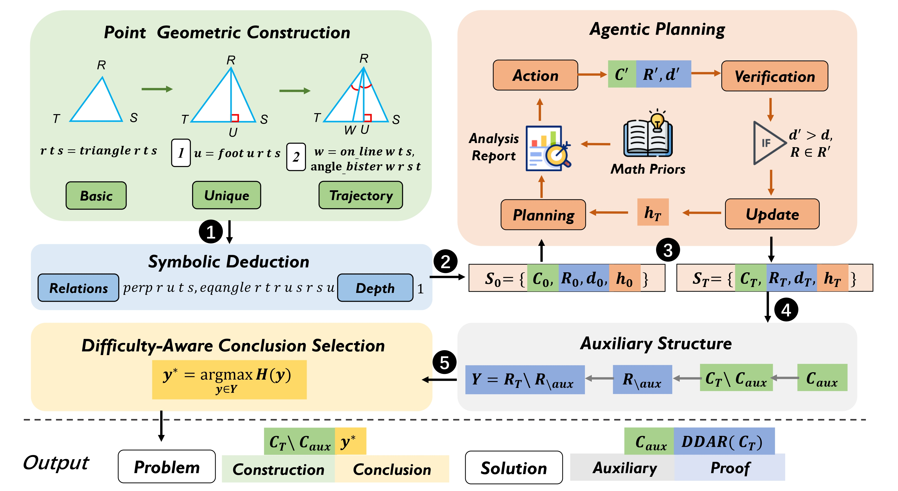

# AuxGeoAgent

[Neurips2026]AuxGeoAgent: Synthesizing Challenging Geometry Proving Data via Planning and Symbolic Deduction


## Abstract

Olympiad-level geometry reasoning remains challenging for large language models, primarily because existing datasets contain limited hard problems requiring long-horizon deduction and hidden auxiliary constructions. To address this gap, we present AuxGeoAgent, an agentic symbolic synthesis framework that formulates problem generation as planning over symbolic construction. Within this framework, an LLM-guided agent iteratively explores construction steps under symbolic constraints and mathematical priors, enabling the generation of structurally challenging problems that benefit from auxiliary constructions. Leveraging this framework, we construct AuxGeo-18K, a compact yet challenging dataset of approximately 18K synthetic geometry proving problems, each accompanied by natural language and symbolic formulations, auxiliary constructions, and complete proof solutions. Unlike prior synthetic corpora that rely on massive data scaling, our approach focuses on the targeted synthesis of difficult instances while using orders of magnitude less data. Experiments on IMO-30 and HAGeo-409 show comparable performance to methods using more advanced symbolic systems, highlighting the effectiveness of our data construction. Our work provides a valuable new resource for Olympiad-level geometric reasoning and advances research in mathematical reasoning.

<p align="center">
  
</p>


## Usage

If you want to run the method, please follow the execution order specified in run.sh.


## Citing this work

```
TBC
```
